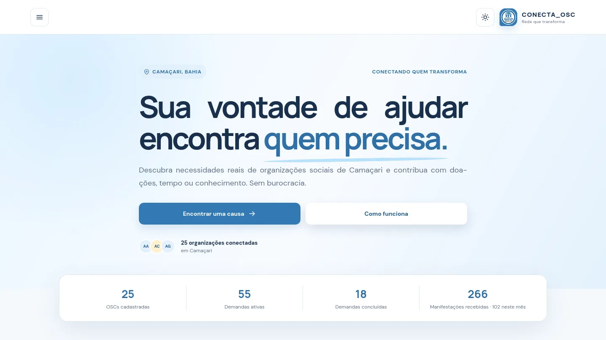
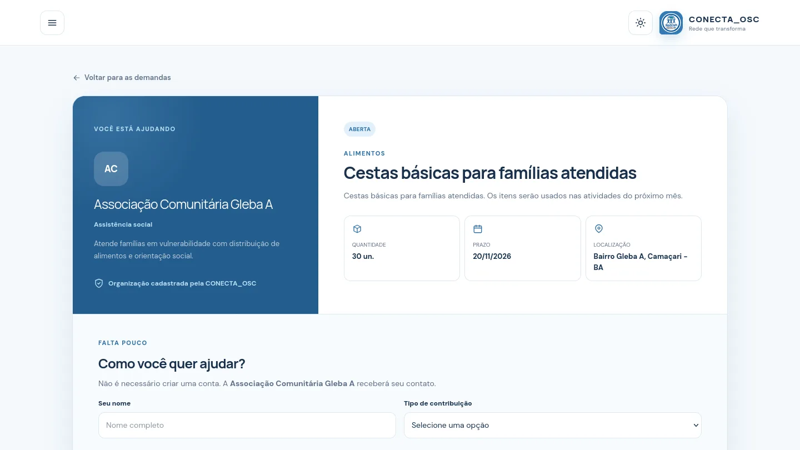
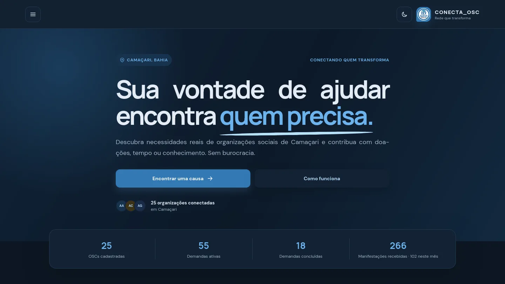
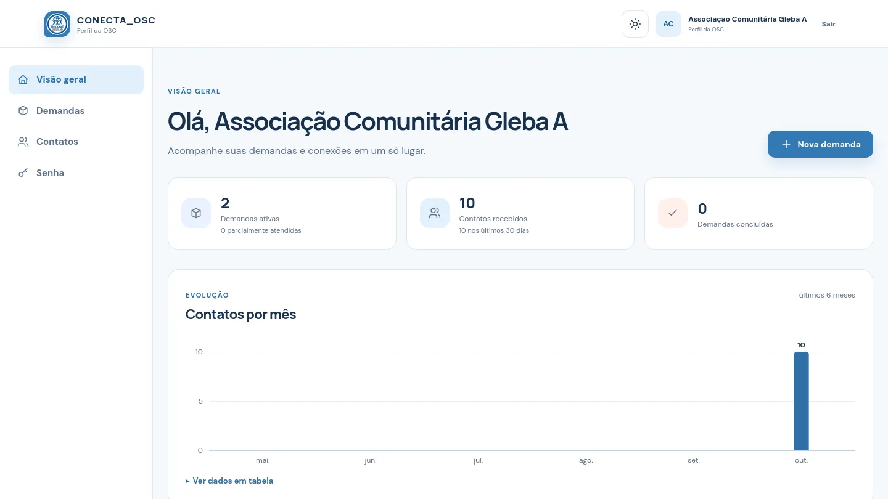
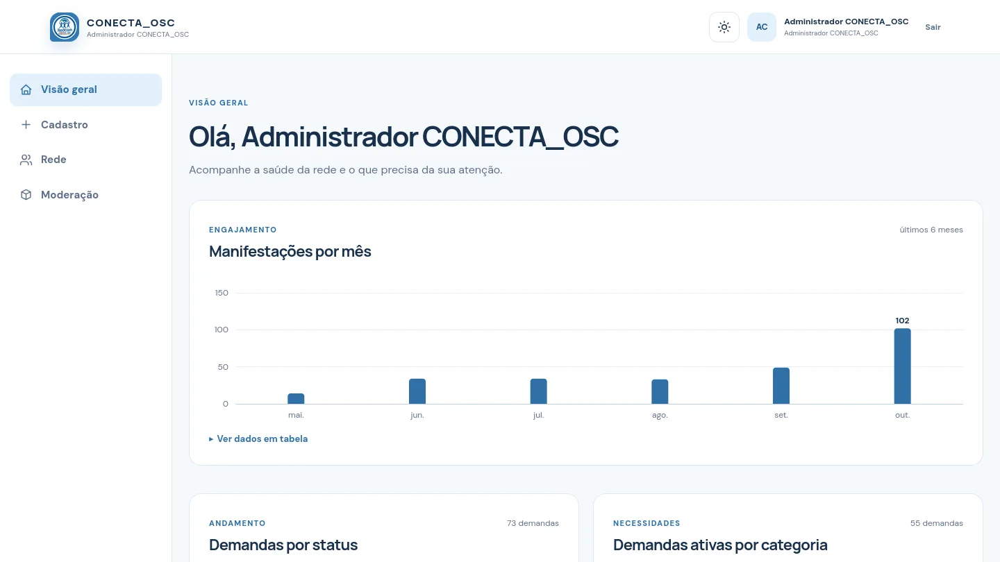
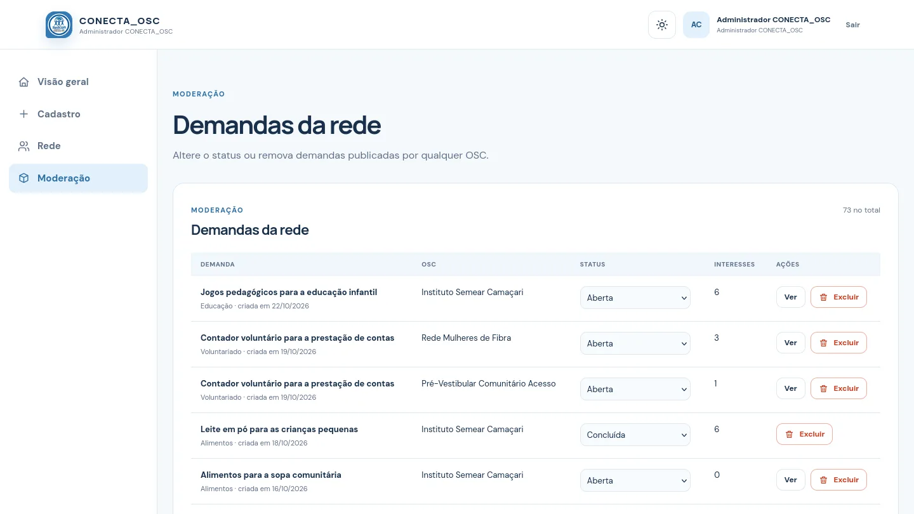
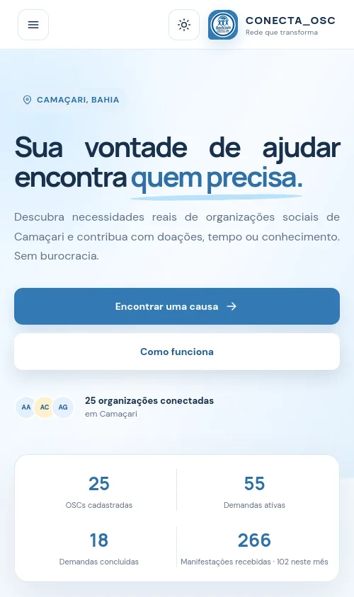
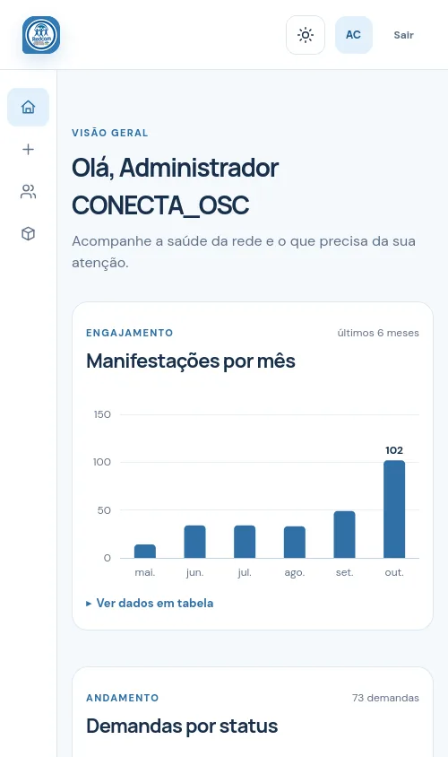
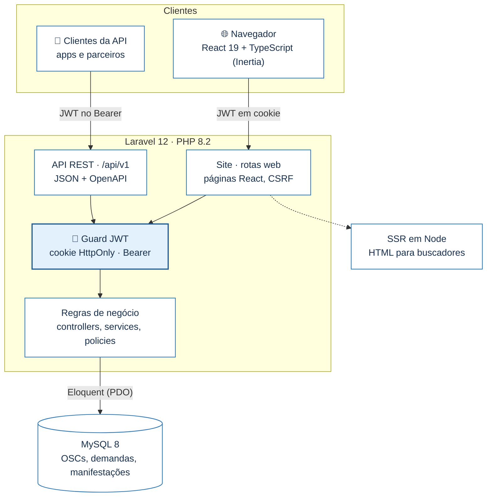

<div align="center">


# CONECTA_OSC

**Sua vontade de ajudar encontra quem precisa.**

Plataforma que conecta as organizações da sociedade civil (OSCs) de Camaçari a quem quer ajudar:
as OSCs publicam necessidades reais, apoiadores encontram e manifestam interesse sem criar conta,
e a equipe da CONECTA_OSC acompanha toda a rede.


<br>


[O projeto](#-o-projeto) ·
[Funcionalidades](#-funcionalidades) ·
[Telas](#️-telas) ·
[Como rodar](#-como-rodar) ·
[API REST](#-api-rest) ·
[Arquitetura](#-arquitetura) ·
[Design system](#-design-system) ·
[Roadmap](#️-roadmap) ·
[Equipe](#-equipe)



</div>

---

## 💙 O projeto

> Projeto de TCC do programa de extensão **DAX Code** · Grupo A, Proposta 1 ·
> **MVP (Versão A) concluído**, com o painel da OSC da Versão B já entregue.

**O problema.** As necessidades das OSCs de Camaçari se perdem em redes sociais e mensagens, e quem
quer ajudar não sabe onde, como, nem se o pedido é legítimo. O resultado é apoio perdido dos dois lados.

**A solução.** Um lugar único e confiável: cada demanda é publicada pela própria organização, com
categoria, quantidade, prazo e status, e o contato do apoiador vai **apenas** para a OSC responsável.

| Perfil | O que faz | Login |
| --- | --- | :---: |
| 🙋 **Apoiador** | Encontra demandas, filtra e manifesta interesse | Não precisa |
| 🏠 **OSC** | Publica e atualiza suas demandas, vê quem quer ajudar | E-mail e senha |
| 🛡️ **Administrador** | Cadastra OSCs, modera demandas e acompanha a rede | E-mail e senha |

### Como funciona

```mermaid
flowchart LR
    A["🛡️ Admin cadastra a OSC"] --> B["🏠 OSC publica a demanda"]
    B --> C["🙋 Apoiador encontra no feed"]
    C --> D["Manifesta interesse<br/>sem criar conta"]
    D -- "contato só para a OSC (LGPD)" --> E["🏠 OSC vê o contato<br/>no painel"]
    E --> F["Atualiza o status:<br/>Aberta → Parcial → Concluída"]
    F -- "concluída" --> G["Sai do feed público"]

    classDef etapa fill:#e2f1fc,stroke:#337ab4,stroke-width:1.5px,color:#18304b
    classDef destaque fill:#337ab4,stroke:#245d8d,stroke-width:2px,color:#ffffff
    class A,B,C,D,F,G etapa
    class E destaque
```



---

## ✨ Funcionalidades

<table>
<tr>
<td width="33%" valign="top">

### 🙋 Área pública

- Feed com as demandas ativas, **urgentes primeiro**
- Filtros por categoria, status e urgência, e busca por título ou organização
- Detalhe da demanda: o que é preciso, quantidade, prazo e a OSC
- **"Quero ajudar"** sem cadastro: nome, contato, tipo de apoio (doação, voluntariado, aluno) e mensagem
- Páginas *Como funciona* e *Sobre a rede*
- Tema claro e escuro

</td>
<td width="33%" valign="top">

### 🏠 Painel da OSC

- Visão geral com **gráficos**: contatos por mês, demandas por status, contatos por tipo
- Criar, editar e excluir demandas
- Atualizar o status até **concluir**
- **Contatos** de quem quer ajudar, com filtros por demanda e tipo
- Troca da senha inicial
- **"Manter conectado"** por 7 dias

</td>
<td width="33%" valign="top">

### 🛡️ Painel do administrador

- **Visão geral**: manifestações por mês, demandas por status e por categoria
- Listas de atenção: **prazos vencidos** e OSCs sem demandas ativas
- **Cadastro** de OSCs, com senha inicial gerada
- **Rede**: editar e excluir organizações
- **Moderação** de qualquer demanda
- Menu lateral fixo, adaptado ao celular

</td>
</tr>
</table>

---

## 🖼️ Telas

<table>
<tr>
<td width="50%"><p align="center"><sub><b>Detalhe da demanda</b> e formulário de interesse</sub></p></td>
<td width="50%"><p align="center"><sub><b>Tema escuro</b>, aplicado já no HTML do servidor</sub></p></td>
</tr>
<tr>
<td width="50%"><p align="center"><sub><b>Painel da OSC</b>: indicadores e contatos por mês</sub></p></td>
<td width="50%"><p align="center"><sub><b>Painel do administrador</b>: visão geral da rede</sub></p></td>
</tr>
<tr>
<td width="50%"><p align="center"><sub><b>Moderação</b> de todas as demandas</sub></p></td>
<td width="50%" align="center"> &nbsp; <p align="center"><sub><b>No celular</b>: feed e painel com menu de ícones</sub></p></td>
</tr>
</table>

---

## 🚀 Como rodar

**Pré-requisitos:** PHP 8.2+, Composer, Node.js 20+ e MySQL 8.

```bash
cp .env.example .env                 # ajuste DB_* e APP_URL
composer install && npm install
php artisan key:generate
php artisan migrate --seed           # cria as tabelas (mesmo esquema do script físico) e o admin padrão

composer dev                         # Laravel + fila + logs + Vite em http://127.0.0.1:8000
```

### Dados de demonstração

Para apresentar o sistema com uma rede realista (25 OSCs, 73 demandas e 266 manifestações fictícias):

```bash
php artisan migrate:fresh --seed --seeder=DemonstracaoSeeder   # ⚠️ apaga o banco antes de recriar
```

| Acesso | Endereço | E-mail | Senha |
| --- | --- | --- | --- |
| Público (apoiador) | `/` | sem login | — |
| OSC | `/osc/login` | `associacao.comunitaria.gleba.a@example.org` | `senha-segura` |
| Administrador (10 OSCs) | `/admin/login` | `admin@uoscc.org` | `admin123` |
| Administrador (15 OSCs) | `/admin/login` | `coordenacao@uoscc.org` | `admin123` |
| Documentação da API | `/docs/api` | sem login (em `APP_ENV=local`) | — |

> O e-mail de cada OSC é o nome dela em minúsculas, sem acentos, separado por pontos e terminado em
> `@example.org` (a lista completa aparece na aba **Rede** do admin). Troque as senhas em produção.
>
> **Sobre os nomes técnicos:** o banco `uoscc_redecam` e os e-mails `@uoscc.org` são nomes técnicos
> mantidos do início do projeto. O nome oficial do sistema é **CONECTA_OSC**.

<details>
<summary><b>Renderização no servidor (SSR)</b></summary>

<br>

Em produção as páginas são renderizadas no servidor (HTML pronto para buscadores e para as prévias de
links compartilhados) e o React "hidrata" esse HTML no navegador:

```bash
npm run build:ssr               # build do cliente + bundle de SSR (bootstrap/ssr)
php artisan inertia:start-ssr   # servidor Node de SSR (porta 13714); use um supervisor em produção
# .env: INERTIA_SSR_ENABLED=true
```

Sem o servidor de SSR o site continua funcionando, renderizado no navegador. Para testar localmente
com SSR: `composer dev:ssr`.

</details>

<details>
<summary><b>Variáveis de ambiente importantes</b></summary>

<br>

| Variável | Para que serve |
| --- | --- |
| `JWT_SECRET` | Chave dos tokens de login (32+ caracteres). Vazia: derivada da `APP_KEY` |
| `JWT_TTL` / `JWT_TTL_SEM_LEMBRAR` | Validade do login com e sem "Manter conectado" (padrão: 7 dias / 2 h) |
| `TURNSTILE_SITE_KEY` / `TURNSTILE_SECRET_KEY` | Anti-robô opcional no formulário público (Cloudflare Turnstile) |
| `CORS_ALLOWED_ORIGINS` | Origens autorizadas a chamar a API pelo navegador |
| `API_DOCS_PUBLIC` | Exibe `/docs/api` fora do ambiente local |

</details>

---

## 🔌 API REST

API JSON em **`/api/v1`**, documentada em **OpenAPI 3.1** (gerada do código pelo Scramble) e navegável
no Swagger em **`/docs/api`**. Cópia da especificação: [`docs/openapi.json`](docs/openapi.json).

| Área | Principais rotas | Autenticação |
| --- | --- | --- |
| Pública | `GET /demandas` · `GET /demandas/{id}` · `POST /demandas/{id}/interesses` · `GET /rede/estatisticas` | — |
| OSC | `POST /osc/tokens` · `GET /osc/painel` · CRUD de `/osc/demandas` · `PATCH …/status` · `GET /osc/contatos` | JWT da OSC |
| Admin | `POST /admin/tokens` · `GET /admin/painel` · CRUD de `/admin/oscs` · moderação de `/admin/demandas` | JWT do admin |

```bash
# 1. Entrar e receber um JWT válido por 7 dias
curl -X POST http://127.0.0.1:8000/api/v1/osc/tokens \
  -H "Content-Type: application/json" \
  -d '{"email":"associacao.comunitaria.gleba.a@example.org","password":"senha-segura"}'

# 2. Usar o token nas rotas protegidas
curl http://127.0.0.1:8000/api/v1/osc/painel -H "Authorization: Bearer <token>"
```

Sem token ou com token inválido a API responde **401**; com token de outro perfil, **403**.
`POST …/tokens/renovar` troca o token por um novo e `DELETE …/tokens/atual` encerra a sessão.

---

## 🧱 Arquitetura



| Camada | Tecnologias | Por quê |
| --- | --- | --- |
| Back-end | PHP 8.2+, Laravel 12, Eloquent | Orientado a objetos, com validação, autorização e consultas parametrizadas |
| Front-end | React 19 + TypeScript via Inertia.js 3, React Compiler, Ziggy | Telas sem recarregar a página, com rotas e props tipadas |
| Estilo | Tailwind CSS 4 + design system próprio | Mobile first, tema claro/escuro por tokens |
| Banco | MySQL 8 | Modelo físico em [`database/schema/uoscc_redecam.sql`](database/schema/uoscc_redecam.sql), espelhado pelas migrations |
| Autenticação | JWT HS256 (`firebase/php-jwt`) | O mesmo token no site (cookie) e na API (Bearer) |
| Qualidade | PHPUnit, Vitest, Testing Library, axe-core, ESLint, Prettier, Pint | Regressões e acessibilidade conferidas a cada mudança |

<details>
<summary><b>Estrutura de pastas</b></summary>

<br>

```
app/
├── Auth/                           login por JWT: guard, emissão e validação dos tokens
├── Http/Controllers/
│   ├── Publico/  Osc/  Admin/      site (retornam páginas React via Inertia::render)
│   └── Api/V1/                     API REST JSON (/api/v1)
├── Http/Requests/                  validação compartilhada entre site e API
├── Http/Resources/V1/              formato dos dados (API e props das páginas) – controle LGPD
├── Http/Middleware/                Inertia, renovação do login, JWT da API, cabeçalhos de segurança
├── Models/  Policies/  Rules/
└── Services/                       regras de negócio (métricas, gestão de OSCs)

resources/js/
├── pages/        uma página React por tela (Publico/, Osc/, Admin/, Erro.tsx)
├── layouts/      LayoutSite, LayoutPainel (menu lateral), LayoutOsc, LayoutAdmin, LayoutAutenticacao
├── components/   componentes reutilizáveis do design system (gráficos, menu, campos…)
├── hooks/        useRotaAtual, useRecarregandoPagina
├── lib/          utilitários (formatação, classes, props tipadas)
└── types/        api.d.ts (gerado do OpenAPI), ziggy.d.ts (gerado) e tipos do domínio

resources/css/    tokens (app.css), temas (theme.css), layout e componentes do design system
database/         migrations, seeders (admin padrão e demonstração) e o script físico do banco
docs/             especificação OpenAPI e imagens deste README
```

</details>

<details>
<summary><b>Práticas do front-end</b></summary>

<br>

- **Tipos gerados**: `types/api.d.ts` vem do OpenAPI (`npm run tipos:api`); uma mudança num Resource do
  Laravel quebra a checagem de tipos onde for preciso ajustar.
- **Estados de requisição**: erros de validação aparecem em cada campo; recargas mostram *skeletons*;
  falhas de rede exibem um aviso global (`AvisoConexao`), sem expor erros técnicos.
- **Aba atual dos menus**: `useRotaAtual` lê a URL da página nas props, igual no SSR e no navegador.
- **Desempenho**: React Compiler, páginas em chunks separados e listas paginadas no servidor.
- **SEO**: cada página define título, descrição e tags Open Graph.

</details>

---

## 🔐 Segurança e privacidade

| | |
| --- | --- |
| 🔑 **Login por JWT** | Token assinado em cookie `HttpOnly` e `SameSite=Lax` (inacessível ao JavaScript). "Manter conectado" vale 7 dias e se renova com o uso; sem a opção, termina ao fechar o navegador |
| 🚪 **Revogação** | Sair invalida o token; trocar a senha derruba todos os logins da conta |
| 🛡️ **LGPD** | Telefone e e-mail do apoiador só aparecem no painel da OSC responsável, nunca no feed nem na API pública |
| 🔒 **Senhas** | bcrypt (`password_hash`), mínimo de 8 caracteres com letras e números, bloqueio após 5 tentativas |
| 🧱 **Ataques comuns** | Consultas parametrizadas (SQL injection), React + CSP com nonce (XSS), token CSRF, HSTS e `X-Frame-Options` |
| 🤖 **Formulário público** | Limite por IP, campo-armadilha, tempo mínimo de envio e Cloudflare Turnstile opcional |

Antes do deploy, rode `php artisan seguranca:verificar`: ele confere HTTPS, debug, chaves, cookies e banco.

---

## ✅ Qualidade

```bash
php artisan test        # 111 testes do back-end (site com assertInertia + API), banco MySQL uoscc_redecam_test
npm test                # 30 testes de componentes React (Vitest + Testing Library + axe-core)
npm run verificar       # TypeScript + ESLint + Prettier + tipos da API em dia
vendor/bin/pint         # padrão de código PHP (PSR-12)
npm run rotas:tipos     # regenera os tipos das rotas após alterar routes/web.php
php artisan scramble:export && npm run tipos:api   # atualiza o OpenAPI e os tipos do front após alterar a API
```

---

## 🎨 Design system

A interface usa um design system próprio em [`resources/css`](resources/css), com tokens que trocam
sozinhos entre os temas claro e escuro (`light-dark()`) e contraste mínimo de 4,5:1 (WCAG AA).

| Token | Claro | Escuro | Uso |
| --- | --- | --- | --- |
| `--color-primary` |  |  | Botões, marca e destaques |
| `--color-primary-dark` |  |  | Chamadas finais e estados de foco |
| `--color-accent` |  |  | Textos e ícones da marca |
| `--color-primary-light` |  |  | Selos, avisos e item ativo do menu |
| `--color-ink` |  |  | Texto principal |
| `--color-coral` |  |  | Urgência e alertas |

**Tipografia:** *Manrope* nos títulos e *DM Sans* no texto. **Componentes:** botões, campos com
validação, selos de status, cartões de demanda, gráficos em SVG acessíveis (com tabela equivalente),
diálogo de confirmação nativo e menu lateral dos painéis.

---

## 🗺️ Roadmap

| Versão | Foco | Situação |
| --- | --- | --- |
| **A · Essencial (MVP)** | Cadastro e login de OSCs e admin, CRUD de demandas, feed com filtros, manifestação de interesse sem login, status e painel do admin | ✅ Concluída |
| **B · Evolução** | Painel da OSC com gráficos | ✅ Entregue |
| | Login de apoiadores com histórico, notificações por e-mail, filtros por bairro/cidade, upload de foto ou comprovante | 🕓 Próximos passos |
| **C · Visão futura** | App mobile e integração com empresas (ESG) | 🧩 Base pronta na API REST |
| | Mapa interativo, doação financeira (PIX/cartão), gamificação e selos | 💡 Ideias |

---

## 👥 Equipe

Desenvolvido pelo **Grupo A** no programa de extensão **DAX Code**, inspirado na rede de
organizações da sociedade civil de Camaçari:

**Gabriel Rodrigues** · **Engenilson** · **Mariana** · **Luna** · **Lauane**

<div align="center">
<br>
<sub>CONECTA_OSC · Um projeto pela comunidade de Camaçari 💙</sub>
</div>
